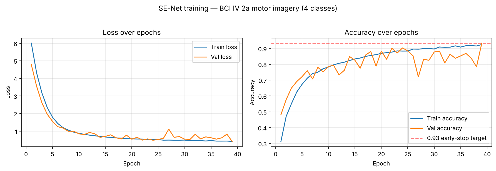

# EEG Motor Imagery Classification (BCI Competition IV 2a)

Classifying four motor-imagery movements — **left hand, right hand, feet, tongue** —
from raw EEG using a custom multi-branch 1D convolutional network with
**Squeeze-and-Excitation (SE)** attention blocks, built in TensorFlow/Keras.

> All metrics and architecture details below are taken from the recorded outputs of
> [`main.ipynb`](main.ipynb) — nothing is estimated.

---

## Overview

Motor-imagery EEG is the basis of many brain–computer interfaces (BCIs): a user
*imagines* a movement, and a model decodes which movement from the brain signal alone,
with no actual motion. This project tackles the classic **BCI Competition IV dataset
2a** benchmark — 9 subjects, 22 EEG channels, four imagined movements — and trains a
convolutional network with channel-wise attention to separate the four classes.

## Problem statement

Given a multi-channel EEG segment (22 channels × 1000 time samples) recorded while a
subject imagines a movement, predict which of **four classes** it belongs to:

| Class | Movement    | BCI IV 2a event code |
| :---: | ----------- | :------------------: |
| 0     | Left hand   | 769                  |
| 1     | Right hand  | 770                  |
| 2     | Feet        | 771                  |
| 3     | Tongue      | 772                  |

## Dataset

- **BCI Competition IV — dataset 2a** (Graz University of Technology), 9 subjects
  (A01–A09), 22 EEG channels at 250 Hz, four motor-imagery classes.
- Trials are extracted at each cue event (codes 769–772); each trial is a window of
  1000 samples across the 22 EEG channels.
- The raw `.gdf` files are **not** redistributed here — download them from the
  [BCI Competition IV site](https://www.bbci.de/competition/iv/) and place them as
  described in [`data/README.md`](data/README.md). Small per-subject event tables are
  committed under [`data/2aEvents/`](data/2aEvents/).

## Data preprocessing and augmentation

Implemented in [`get_data.py`](get_data.py) and `main.ipynb`:

1. **Event extraction** — read each subject's `.gdf` with MNE, locate the four
   motor-imagery cue events, and slice a 1000-sample window of the 22 EEG channels at
   each cue.
2. **Interpolation** — each trial is interpolated along the time axis (to 1050 samples)
   with `scipy.interpolate.interp1d`.
3. **Cropping augmentation** — overlapping crops are taken from the interpolated trials
   and concatenated back with the originals, enlarging and regularizing the training
   set.
4. **Label mapping** — event codes 769/770/771/772 → classes 0/1/2/3.
5. **Shuffle & split** — stratified shuffle, then an 80 / 10 / 10 split into
   train / validation / test (`train_test_split`, `random_state=1`).

## Model architecture

A **three-branch 1D CNN with Squeeze-and-Excitation attention**, defined in
`main.ipynb`. The same `(1000, 22)` input is fed to three parallel branches that use
different convolutional kernel sizes, so the network sees the signal at multiple
temporal scales:

- **Branch 1** — kernels 20 → 9 → 5 → 5 → 3 → 3, with two residual (skip) connections.
- **Branch 2** — kernels 13 → 7 → 5 → 3 → 3, with a residual connection.
- **Branch 3** — kernels 15 → 10 → 5 → 3, widening to 48 filters.

Each convolutional stage is `Conv1D → BatchNorm → ELU → SE block`, with `MaxPooling1D`
for downsampling, L2 weight regularization, and `Dropout(0.5)`. The three branches are
flattened, concatenated, and passed through a final `Dropout` and a `Dense(4, softmax)`
output.

**Squeeze-and-Excitation block** (channel attention): global-average-pool across time →
`Dense(C/8, ReLU)` → `Dense(C, sigmoid)` → rescale the input channels by the learned
weights, letting the network emphasize the most informative feature channels.

## Training

| Setting            | Value                                           |
| ------------------ | ----------------------------------------------- |
| Loss               | sparse categorical cross-entropy                |
| Optimizer          | Adam (learning rate 5e-4)                       |
| Batch size         | 70                                              |
| Max epochs         | 54 (early-stopped)                              |
| Regularization     | L2 on conv layers + Dropout(0.5)                |
| Checkpointing      | best `val_loss` → `model_checkpoint.h5`         |
| Early stopping     | custom callback, stops once `val_accuracy ≥ 0.93` |
| Seed               | `tf.random.set_seed(1234)`                      |

Training early-stopped at **epoch 38** when validation accuracy reached the 0.93 target
(final epoch: train acc 0.925, val acc 0.933).



## Results

On the held-out **test split** (from `main.ipynb`):

| Metric        | Value   |
| ------------- | ------- |
| Test accuracy | **0.9218** |
| Test F1 (weighted) | **0.9218** |
| Test loss     | 0.4172  |

Best validation accuracy during training was **0.9333**. These are strong results for
4-class motor-imagery decoding on BCI IV 2a (a benchmark where many published models
land in the 0.70–0.85 range), though note the caveats below.

## Repository structure

```
EEG-based-motor-imagery-classification-/
├── README.md
├── LICENSE                      # MIT (code only; dataset has its own terms)
├── requirements.txt
├── .gitignore
├── main.ipynb                   # ← the complete pipeline: data → model → train → eval
├── get_data.py                  # EEG loading & event extraction (imported by main.ipynb)
├── data/
│   ├── README.md                # how to obtain BCI IV 2a + data layout
│   └── 2aEvents/                # per-subject event tables (A01T…A09T .xlsx)
├── models/
│   ├── README.md                # how to load the checkpoint
│   └── model_checkpoint.h5      # trained SE-Net weights (~4.4 MB)
├── scripts/
│   └── getEvents.m              # MATLAB: export GDF events → Excel (Biosig sload)
├── experiments/                 # earlier / alternative notebooks (see its README)
│   ├── colab.ipynb  get_data.ipynb  SE.ipynb  test.ipynb
│   └── README.md
└── assets/
    └── training_curves.png
```

## Installation

Developed on **Python 3.8** with TensorFlow 2.x / Keras.

```bash
git clone https://github.com/NimaAhmadi79/EEG-based-motor-imagery-classification-.git
cd EEG-based-motor-imagery-classification-
python -m venv .venv && source .venv/bin/activate   # optional
pip install -r requirements.txt
```

`mne` and `easygdf` are needed to read the `.gdf` files. A GPU is recommended for
training but not required.

## Running the project

1. Download the BCI IV 2a `.gdf` files and lay them out as described in
   [`data/README.md`](data/README.md).
2. Open `main.ipynb` (Jupyter or Colab) and run top to bottom. It loads the data via
   `get_data.py`, builds the SE-Net, trains with checkpointing + early stopping, and
   reports test accuracy and F1.
3. To skip training and just use the trained model, load
   `models/model_checkpoint.h5` (see [`models/README.md`](models/README.md)) and call
   `model.predict([x, x, x])`.

## Inference example

```python
import tensorflow as tf
import numpy as np

model = tf.keras.models.load_model("models/model_checkpoint.h5")

# x: EEG trials, shape (n_trials, 1000, 22)
probs = model.predict([x, x, x])      # the network has 3 identical inputs
labels = probs.argmax(axis=1)         # 0=left hand, 1=right hand, 2=feet, 3=tongue
```

## Technologies

Python · TensorFlow / Keras · MNE-Python · easygdf · scikit-learn · SciPy · NumPy ·
pandas · Matplotlib · MATLAB (Biosig, for event export).

## Limitations and possible improvements

- **Subject-pooled evaluation.** Trials from all 9 subjects are pooled and then split,
  so the test set can contain trials from subjects seen in training. The standard BCI
  IV 2a protocol evaluates *within-subject* (train on `*T`, test on `*E`) or
  leave-one-subject-out; those are harder and would give a more conservative, more
  comparable number. The 92% here should be read with that in mind.
- **Augmentation leakage risk.** Interpolated/cropped copies are created before the
  train/test split, so augmented variants of a trial could land on both sides of the
  split. Splitting first, then augmenting only the training set, would make the metric
  more trustworthy.
- **Single run, single split.** Results come from one seed/split; cross-validation
  would quantify variance.
- **No baseline comparison.** A simple baseline (e.g. CSP + LDA, or a plain CNN) would
  put the SE-Net's gain in context.

These are good next steps rather than flaws in the idea — the architecture and pipeline
are sound; the evaluation protocol is where the most rigor could be added.

## License

Code released under the **MIT License** — see [`LICENSE`](LICENSE). The BCI Competition
IV dataset 2a is **not** covered by this license and remains under its original terms;
see [`data/README.md`](data/README.md).

## Author

**Seyed Nima Ahmadi** — [GitHub @NimaAhmadi79](https://github.com/NimaAhmadi79)
